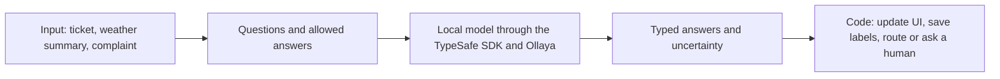

# Presenter guide: Decision models, live

> Publication update, 5 November 2026: the sections below preserve the historical rehearsal audit. Use the README for current setup. Acts 1, 2 and 4 replay from the public files; Act 3 requires separately downloaded local data and matching local recordings. Never publish its raw sample or derived recordings. `--replay` now activates before routing; the shuffle test explicitly skips the invalid cached comparison; safety reporting includes every gold safety case and reports actual flags. Safety detection and forecast-window limitations remain. New live recordings go to ignored `data/recordings/`. Historical claims about a committed complaint sample or the original dependency environment do not describe the public package.

Verified on this laptop on **28 October 2026**. Start with the rehearsal below; the rest explains what you are seeing and what to improve.

**Audience:** developers with basic LLM knowledge who want to understand decision models. **Hard limit: 30 minutes**, including questions and delays. Plan 25 minutes of content and reserve five minutes. Section 5 is the stage plan; the rest is preparation and reference material.

## 1. Where the demo stands

**This is a working developer-talk prototype with four implemented acts and recorded answers for an offline rehearsal.** The original run-of-show totals 45 minutes. For the confirmed 30-minute limit, present Act 1 and Act 4 as one support-ticket story; keep weather and data engineering as backup material. Its evaluation and presentation claims need corrections before an external presentation.

| Part | Implemented | Verified in this review |
| --- | --- | --- |
| Act 1: primitives | Raw HTTP request, three typed questions, language/context/arithmetic failure examples | Both Python scripts pass in replay; raw HTTP and the three-question SDK request also work against the local model |
| Act 2: weather | FastAPI backend, browser UI, city/model selectors, recorded weather | All 16 city/model combinations return recorded answers; London and a model switch work in the browser |
| Act 3: data engineering | 300 public complaint narratives, labelling pipeline, DuckDB storage and SQL reports | All 900 recorded labels across three models replay with zero errors; reports reproduce |
| Act 4: support | 40 English/Portuguese tickets, two-model routing policy, human handoff, evaluation | Full replay evaluation runs; several evaluation claims are misleading, detailed below |
| Handoff | README run-of-show, glossary, setup and warmup scripts | Most implementation files and fixtures are still untracked in Git |

The local Python environment and all five model checkpoints are already installed. The model server answered a real request during this review. There is no need to download the models again for your first rehearsal.

There is no slide deck, training pipeline, or real support-system integration in the inspected files. Weather regression tests were added on 29 October; the original audit had no automated test suite. “Route to a human” returns a decision and prints a trace; it does not create or assign an actual support ticket. This repo configures existing models and measures their answers; it does not train a model.

At the start of this review, the current Git commit tracked only `.gitignore` and `README.md`. A checkout of that commit alone would not contain the working demo. Share the implementation, reviewed fixtures and dependency lock; keep the raw sample, Act 3 recordings, `data/` and `.venv/` excluded.

## 2. Understand the idea in two minutes

For this audience, lead with a familiar engineering question: **“If my application only needs a category or a score, what changes when the model scores those answers directly?”** Assume they already understand prompts and token generation; spend the introduction on the output mechanism, the application contract, and the evidence needed to justify another model.

The question behind the talk is: **Can a model turn messy input into a small answer that ordinary code can act on?**

For example, a customer writes a complaint. You provide the complaint, a question, and the allowed answers. The model returns a selected queue and numbers describing its answer. Your code decides whether to route it, ask a stronger model, or ask a person.



You need only these terms initially:

| Term | Plain English | Example in this demo |
| --- | --- | --- |
| State | The input to judge | A customer's ticket |
| Choice | Pick one allowed category | `billing`, `technical`, or `account` |
| Score | Place the input on an ordered scale | Urgency from “can wait” to “today”; the returned score can be fractional |
| Noul | Return a probability for a yes/no statement | “The customer asks for money back” |
| Confidence | A number describing how decisive the answer is | Used by code to decide whether to accept the answer |
| Gate | A threshold in your code | Below a threshold, ask a person |
| Cascade | Try a small model, sometimes ask a larger one | `laya` first, `kev:4b` second |
| Replay | Look up a previously recorded answer | Rehearse without running models |

**Confidence is not measured accuracy.** A confidence of 0.95 does not establish that 95% of similar decisions will be correct. The failures in this repo make that distinction visible. The Choice's winning probability and its confidence are also different fields.

The moving parts are:

- **Python application:** defines the input, questions, allowed labels, and routing policy.
- **TypeSafe SDK:** the Python client used to send typed questions.
- **Ollaya:** the local server, normally on port 11435.
- **laya / kev:** the actual local models making these decisions. Jev is not the engine used here; the repo uses its API contract through a compatible local server.
- **`dm/`:** the shared wrapper, terminal formatting, and recording/replay layer.
- **`fixtures/`:** recorded inputs and model answers. These are real recordings, not a new inference each time you replay them.
- **DuckDB:** a local analytical database used to save and query Act 3 labels.

The API responses contain structured values and report zero output tokens. The weather headlines and colours are generated by normal application code from those values.

### The comparison developers will ask for

| Question | Generative LLM with structured output | Decision models used in this demo |
| --- | --- | --- |
| What does the application supply? | Input, instructions, and an output schema | State, typed questions, option descriptions or ordered levels |
| How is the answer obtained? | Generate tokens under constraints that enforce the requested structure | Score the supplied options or levels, then return values and distributions |
| Can the answer have a reliable shape? | Yes: constrained generation can enforce a schema | The typed API defines the available answer shapes |
| What uncertainty does the application receive? | Depends on the API and scoring method; a generated `confidence` field needs validation | Per-option probabilities and a derived confidence for Choice/Score, or a yes probability for Noul |
| What should decide which approach to use? | Measured accuracy, latency, cost, flexibility, and review workload | The same measurements on the same task |

Structured generation already constrains LLM outputs, including JSON; present it as a credible baseline. The mechanism still selects output tokens sequentially under a grammar. [Hugging Face's explanation of constrained generation](https://github.com/huggingface/text-generation-inference/blob/main/docs/source/conceptual/guidance.md) describes that process. The table is an engineering comparison, not a benchmark performed by this repo.

Explain “new type of AI” as a **specialisation for bounded decisions**. Choosing, scoring, and classification are familiar tasks; the interesting developer proposition is defining those questions in natural language at request time and using their scores directly in application policy. Avoid presenting the category name as proof of a wholly new architecture or better performance.

### What runs under the hood here

The models in the demo use different backbones. `laya:en` uses ModernBERT-large, an encoder; `laya:multilingual` uses mmBERT-base. [Ollaya's Laya documentation](https://ollaya.dev/library/laya) describes their decision interface and warns about overconfidence in the raw checkpoints. `kev` adapts a Qwen3.5 base with LoRA and a small pointer head that scores the supplied options. It does not generate an explanatory response in this path. [Ollaya's Kev documentation](https://ollaya.dev/library/kev) describes that mechanism.

**One HTTP request does not establish one forward pass for every question together.** Kev performs a forward pass per question and rereads the state for each. Do not transfer TypeSafe's claims about Jev's parallel-question behaviour to every backend sharing its API. This demo measures local Laya and Kev, not hosted Jev.

TypeSafe uses “System One” for fast, focused judgments, drawing an analogy with fast human thinking. Treat that as terminology for the product category, not a claim that this demo establishes human-like cognition. [TypeSafe's System One definition](https://docs.typesafe.ai/concepts/system-one) explains the term.

### Three distinctions to make explicit

1. **Type validity and decision correctness:** an answer can be a valid queue name and still be the wrong queue. Show the ambiguous Portuguese support ticket to make this concrete.
2. **Confidence and calibration:** confidence summarises a model's distribution; calibration asks whether probabilities match observed outcomes across many examples. A high number alone establishes neither accuracy nor calibration. [TypeSafe's confidence reference](https://docs.typesafe.ai/confidence) defines the derived statistic.
3. **Prediction and permission:** a model proposes a route; code controls whether to accept it, escalate, or involve a person. The threshold policy is application logic, not another capability learned by the model.

A suitable opening script is: “You already use LLMs to turn text into structured data. Here we will try models specialised for choosing and scoring predefined answers. We will inspect the probabilities, wire them into code, and measure the mistakes. The question is whether that specialisation earns its place in our stack.”

## 3. Familiarisation: explore the examples at your own pace

This section covers all four implemented acts so you can understand the repo. It is not the timed stage sequence. For the 30-minute talk, practise Steps A and E first, then follow section 5. Explore weather and the database separately if useful for your own understanding.

These instructions use the existing local environment. All commands start in this folder:

```bash
cd decision-models-demo
```

On a machine without dependencies, run `uv sync --locked` first. Replay needs the Python dependencies, sample CSV, and fixtures, but no model downloads. `scripts/setup.sh` also downloads the models, so it is unnecessary for an offline-only rehearsal.

If `uv` has a local cache problem on this laptop, the existing environment can run the same scripts with `.venv/bin/python` in place of `uv run`.

### Step A: See the three answers

```bash
uv run act1_primitives/02_primitives.py --replay
```

Read the ticket aloud, then explain the output:

- The queue is **billing**. Its winning probability is about 94.9%, while confidence is about 0.92.
- Urgency is about **1.89 on a 0–2 scale**, near “needs attention today.”
- The refund statement gets about **89.7% probability**.
- `cached` means this answer was recorded before. The displayed milliseconds are the recorded call's duration.

Try explaining those four points without reading the code. That is enough technical understanding for the opening demonstration.

### Step B: See why the numbers need checking

```bash
uv run act1_primitives/03_where_it_breaks.py --replay
```

Look for three observations: models disagree on a Portuguese ticket, a long input is refused, and arithmetic comparisons get only **3 of 6** correct in this recording. Some wrong arithmetic answers are very confident.

Say: “We keep arithmetic in code and evaluate the model on the language task we actually need.”

### Step C: Use the browser demo

In a separate terminal, start this if port 8000 is not already serving the demo:

```bash
uv run act2_weather/app.py --replay
```

Open <http://127.0.0.1:8000>. Keep that terminal running. Stop it with Ctrl-C when finished.

The page labels replay mode and starts with Lisbon. **Get my location** is disabled in replay: restart the command without `--replay` for live weather. In live mode, that button requests a new position, weather, and model decision without saving the result. See the 29 October update in section 9.

1. Pick **London** from “sample city.” Replay does not contain your arbitrary current location.
2. With **laya:en**, look at transport: the recorded winner is **bike**, with low confidence, about 8%.
3. Switch to **kev:4b**. The recorded winner becomes **bus**, at about 31% confidence.
4. Scroll through all three cards. The state sentence stays the same while the answers change.
5. Try **Lisbon** and **Porto**. Ask whether each recommendation is plausible and whether the uncertainty is understandable.

This demonstrates the connection between a typed answer and UI behaviour. The weather itself is a recording from **21 October 2026**, not today's forecast. There is also a time-window bug in the weather summary, described below; do not claim the current code is a reliable next-hours forecast.

The model sees only the sentence. In live mode the weather provider receives coordinates to fetch weather; the model request does not include those coordinates.

### Step D: See text become database rows

In your command terminal:

```bash
uv run act3_nhtsa/label.py --model laya:typed-decisions --replay --workers 1
uv run act3_nhtsa/label.py --model kev:0.8b --replay --workers 1
uv run act3_nhtsa/label.py --model kev:4b --replay --workers 1
uv run act3_nhtsa/report.py
```

These create or replace each model's labels in local `data/labels.duckdb`. They use the 300-row sample and do not download the full NHTSA archive. Read the headline table, then the gate sweep. You do not need to explain every row of terminal output.

**Avoid `--limit` before presenting the full report:** a limited run replaces that model's full stored labels with the smaller subset. Rerun its full 300-row replay to restore the report.

For a SQL walkthrough in the VS Code terminal, open the existing database read-only:

```bash
duckdb -readonly /path/to/decision-models-demo/data/labels.duckdb
```

Then paste:

```sql
SELECT
    c.MAKETXT AS make,
    l.pred_group AS component,
    count(DISTINCT l.cmplid) AS complaints
FROM labels l
JOIN read_csv_auto(
    '/path/to/decision-models-demo/act3_nhtsa/sample_300.csv'
) c ON l.cmplid = CAST(c.CMPLID AS VARCHAR)
WHERE l.model = 'kev:4b'
  AND c.MAKETXT IN ('VOLKSWAGEN', 'AUDI')
GROUP BY 1, 2
HAVING count(DISTINCT l.cmplid) > 1
ORDER BY complaints DESC, make, component;
```

These are predicted-component complaint counts in the balanced demo sample, not fleet-wide rates. Filtering to one labeling model avoids counting multiple models' labels together.

### Step E: Follow a routing decision

Use `DM_REPLAY=1` before launching the support scripts. Their current `--replay` flag is applied too late to guarantee offline behaviour on a cache miss; the environment prefix avoids that bug.

```bash
DM_REPLAY=1 uv run act4_support/route.py --all --limit 3 --replay
DM_REPLAY=1 uv run act4_support/route.py "It is not working. Please fix it as soon as possible." --replay
DM_REPLAY=1 uv run act4_support/route.py "Isto nunca mais funciona, ja estou farto. Resolvam." --replay
DM_REPLAY=1 uv run act4_support/eval.py --replay
```

The first command shows clear billing tickets routed automatically. The second shows an unclear ticket going through two models and then to a human. The third deliberately shows a failure: an ambiguous Portuguese ticket is confidently auto-routed to `app_technical`, against the fixture's `general` label.

Keep the quoted text exact in replay, including punctuation. New text needs a model call and a new recording.

In the evaluation, focus on **per-tier accuracy** and **full cascade outcome**. Skip the shuffle-test conclusion until the cache defect is fixed.

## 4. What the recorded results actually say

These figures were reproduced from the local fixtures during this review. They are sample results, not an estimate of production performance.

| Measurement | Result | Interpretation |
| --- | --- | --- |
| Act 3 component agreement, `laya:typed-decisions` | 38.0% of 300 rows | Weak agreement with the dataset's mapped component labels |
| Act 3 component agreement, `kev:0.8b` | 46.3% of 300 rows | Better, but still limited |
| Act 3 component agreement, `kev:4b` | 52.7% of 300 rows | Best of these recordings; it still misses nearly half |
| Act 3 `kev:4b`, component confidence at least 0.60 | 76.6% agreement on 94 rows | A cleaner subset, with much lower coverage; this uses component confidence alone |
| Act 3 `kev:4b`, minimum confidence across all three answers at least 0.35 | 24.7% auto-accepted, 60.8% component agreement | A different gate from the component-only subset above |
| Act 4 `laya` alone | 24/40 correct, 60.0% | Fast first model, frequent mistakes |
| Act 4 `kev:4b` alone | 37/40 correct, 92.5% | Stronger on these tickets |
| Act 4 full cascade | 26/40 auto-routed; 22/26 correct, 84.6% | Four wrong automatic routes; 14 tickets go to a human |
| Act 4 second-model use | 17/40 tickets, 42.5% | The cascade avoids some larger-model calls, at an accuracy cost |

For Act 3, component “truth” is a coarse mapping of the source categories. The safety proxy records crashes, fires, and injuries; it does not directly label whether a defect could cause future harm. The reported safety-flag accuracy is therefore a comparison between different concepts, not a validated safety detector.

For Act 4, thresholds were tuned using the same 40 handwritten tickets used in evaluation. There is no independent held-out test set here. Human handoff also does not establish that the eventual human answer is correct; the report only measures the automatic subset.

The gate sweep does **not** show that raising confidence always improves accuracy. For example, tier-1 automatic accuracy drops from 82.4% at HIGH=0.90 to 70.0% at HIGH=0.95. The selected subset changes and the sample is small.

Reported timings in replay are historical model-call timings. Act 3's recordings used concurrent workers and include contention. Do not divide those times by a guessed factor or present them as a fresh latency benchmark. A direct three-question `laya:en` SDK call took about 101 ms in this review; that is one warm request, not a benchmark.

## 5. The 30-minute stage plan

**Do not try to demonstrate all four acts.** The original 45-minute script already consumes the entire slot before allowing for questions or delays. Use one support-ticket story: define a decision, put it into a routing policy, then inspect the mistakes.

By the end, an audience member should be able to explain what a decision model returns, how code uses that answer, and what must be measured before trusting it.

### A 25-minute talk with five minutes reserved

| Time | Show | Explain | Transition to the next part |
| --- | --- | --- | --- |
| 0–3 min | A support ticket and the question “Why use this when my LLM supports structured output?” | Compare constrained generation with scoring supplied answers. This is a conceptual comparison; the repo has no measured LLM baseline | “Let's inspect the smallest request.” |
| 3–8 min | Act 1's three-question SDK example and its recorded output | Choice = queue, Score = urgency, Noul = refund probability. Point at input, criteria, and returned fields | “An answer is useful when code can decide what to do next.” |
| 8–11 min | One simple input → model → scores → code diagram | Give a brief account of option scoring and where the SDK/server/model fit. Mention that local Laya/Kev are different backends from hosted Jev | “Now we can use those scores to route work.” |
| 11–18 min | A clear support ticket, an unclear ticket, and the confidently wrong Portuguese example | Show automatic routing, escalation, and human review. The thresholds belong to application code | “Those three examples are illustrations; what happens over the whole set?” |
| 18–22 min | The full-cascade summary: 26 auto-routed, 22 correct, four wrong; 14 to humans | Valid types and confidence do not establish correctness. The 40 tickets were also used for tuning, so this is not a held-out result | “What evidence would justify using this in our own stack?” |
| 22–25 min | One proposed low-impact pilot and three takeaways | Define the answer space, keep policy in code, and compare errors/latency/review workload against alternatives | Close the prepared content by minute 25 |
| 25–30 min | Questions and recovery time | Use the reserved time for discussion or any earlier delay | End by minute 30 |

These are editorial time budgets, not measured speaking times. Confirm them with a stopwatch rehearsal; script execution speed is only a small part of the slot.

### What to keep in backup

- **Weather:** useful visual illustration, but introduces another domain and browser transition. Keep it for an audience question after the main talk, time permitting; it is not scheduled in the 25 minutes.
- **NHTSA/DuckDB:** useful follow-up for a data-engineering audience. Share the commands and report after the talk instead of running the pipeline on stage.
- **Raw HTTP:** duplicates the SDK demonstration. Keep it for “what does the API look like?” questions.
- **The full failure script and model matrix:** the wrong support route already demonstrates the key limitation. Language, arithmetic, context-window, and checkpoint details can stay in the reference guide.
- **Full gate sweeps, injection, shuffle, and safety tables:** too much detail for this introduction; some currently contain the defects documented in section 7. Do not present the misleading conclusions.

### Minimal on-stage command sequence

Use the already verified recordings and announce that mode. Keep the model-loading and setup steps out of the slot. From the repository root:

```bash
# 3–8 min: one input, three typed answers
uv run act1_primitives/02_primitives.py --replay

# 11–18 min: clear ticket, automatic route
DM_REPLAY=1 uv run act4_support/route.py --all --limit 1 --replay

# Unclear ticket, escalation and human review
DM_REPLAY=1 uv run act4_support/route.py "It is not working. Please fix it as soon as possible." --replay

# Confident mistake: expected general, predicted app_technical
DM_REPLAY=1 uv run act4_support/route.py "Isto nunca mais funciona, ja estou farto. Resolvam." --replay

# 18–22 min: show only the verified full-cascade summary
DM_REPLAY=1 uv run act4_support/eval.py --replay | tail -n 6
```

The last command runs the existing evaluation and displays only its full-cascade summary; it does not fix or validate the earlier shuffle, injection, or safety-report sections. Keep the full output available for preparation and disclose the known issues if asked.

Do not solicit arbitrary tickets during the scheduled demonstration: replay requires exact recorded input, and a new live request can introduce loading time and debugging. Discuss audience examples during questions if there is time.

### Make the explanation easier to follow

Use the same customer-support problem throughout. First say “input,” “allowed answers,” and “review threshold”; introduce State, Choice, Score, Noul, and Gate alongside the fields when they appear. Describe Noul initially as “the API's yes/no probability.” Mention product names only when locating the SDK, local server, and model in the diagram.

Keep three distinctions visible: **valid output versus correct decision; confidence versus measured reliability; model prediction versus code policy**. These are the audience's checkpoints. Avoid promising that typed outputs, faster inference, or a named model category automatically settle the accuracy question.

End with: “You can define a bounded judgment in natural language, receive scores your code can use, and choose when to ask for review. Whether this is better than your current approach is something to measure on your own task.”

### Rehearsal and overrun rules

1. Preflight the five commands before presenting, enlarge the terminal font, and have their saved output available.
2. Do one complete spoken rehearsal, including reading output, transitions, and explaining the unfamiliar fields. Aim to finish the prepared content in 23–25 minutes.
3. At minute 18, move to the aggregate result even if one ticket example remains. At minute 22, move to takeaways. Stop prepared content by minute 25.
4. If the rehearsal exceeds 25 minutes, shorten the architecture explanation or use two ticket traces. Preserve one failure, the aggregate result, and the five-minute reserve.
5. Ask a developer who has not seen the repo to explain back the input, answer, next action, and one limitation. That is the clarity check; a clean script run alone cannot establish it.

The current source material has readable individual examples, but the original four-domain sequence and product terminology make the overall story harder to follow. This reduced plan addresses that structure; delivery clarity and timing still need a spoken rehearsal. There is no slide deck in the inspected repo to assess visually.

## 6. Optional: try a real model request yourself

The models are installed on this laptop. If the server is stopped, start `ollaya serve` in another terminal. If it says a server is already running, continue.

```bash
bash act1_primitives/01_raw_http.sh
```

This script really calls the server and has no replay implementation. It should return `invoice` for the sample request.

To try your own ticket:

```bash
env -u DM_REPLAY uv run act4_support/route.py "My Zephyra app crashes every time I open the map. My first rehearsal example."
```

Use a new sentence to get a new inference. **Removing `--replay` does not force a fresh request:** the wrapper always checks the fixture cache first. New live requests write answers to ignored `data/recordings/act4.jsonl`. The routing output's milliseconds may come from the published recording when a fixture matches.

Loading `kev:4b` for the first request can take noticeably longer and requires substantial memory. Use the recorded support examples for your first run; do not run a full live evaluation as part of learning the demo.

For live weather, stop the replay weather server with Ctrl+C and restart `uv run act2_weather/app.py` in your terminal. Keep Ollaya running in another terminal. Every live weather/model request is fresh and leaves the city and decision replay files unchanged. The forecast-window issue remains open, so do not describe the summary as a validated next-hours forecast.

## 7. Improvements to request before presenting

These are verified implementation issues or explicit evidence gaps. They were documented, not patched, in this review.

| Priority | Issue and evidence | Requested change and acceptance check |
| --- | --- | --- |
| Before handoff | Most demo files and all fixtures are untracked; current HEAD contains only two files | Commit the intended source, reviewed Act 1/2/4 fixtures and lockfile; exclude the raw sample and Act 3 recordings. Verify the replay sequence from a fresh checkout |
| Before claiming order stability | `dm/client.py` hashes JSON with `sort_keys=True`, including Choice criteria. Reversing options produces the same key, so `shuffle_test` reuses the original response | Preserve the relevant option order in the cache identity. Record new shuffled requests and rerun the test; ensure original and shuffled request keys differ |
| Before relying on offline fallback | `act4_support/route.py` creates `_decider` before parsing `--replay`; `eval.py` imports it before parsing too. A new input still reaches the network path after the flag | Set replay before constructing the client, or pass it explicitly. Test an unknown ticket with networking blocked: it must raise a replay miss without attempting a call. Use the `DM_REPLAY=1` workaround meanwhile |
| Before claiming safety tickets are always flagged | Ticket `t24` is auto-routed to `vehicle_safety` with `flagged=false`: tier 1 misses safety, tier 2 finds it, but the safety gate uses only tier 1's suspicion. Evaluation prints `auto(safety,flagged)` anyway | Recheck safety after tier 2, apply the stricter policy, and render the real flag. Verify `t24` cannot bypass the safety policy and that the evaluation asserts the flag |
| Before claiming a next-hours forecast | `act2_weather/app.py` reads `hourly[:12]`. Recorded hourly timestamps run 00:00–11:00 while the current observations are around 19:45 | Select hours by timestamp from the current observation onwards, fetch enough forecast days to cross midnight, and verify an evening example excludes the morning |
| Before calling the other acts live | Cached answers are returned even outside replay; several outputs show recorded latency without a clear mode. Live weather was fixed on 29 October | Add a fresh/live option and consistent mode/provenance labels to the other acts. Verify a forced live request actually reaches the server |
| Before claiming calibrated reliability | Thresholds use the same 40 tickets as evaluation; confidence can be high on wrong answers | Separate tuning and evaluation data, report sample counts and errors, and measure confidence reliability on unseen data |

Also improve the injection reporting: `t35` chooses the injected `billing` label at tier 1 and is handed to a human because confidence is low, yet the report says “ignored injection.” Describe it as **contained by the gate**, and distinguish incorrect intermediate predictions, human handoffs, and wrong automatic actions. Three recorded examples do not demonstrate general injection resistance.

Useful follow-up work after those corrections:

- Add a one-command offline smoke check covering every act, missing fixtures, and the routing invariants above.
- Add weather observation timestamps. A visible mode label and a recorded default city were added on 29 October.
- Show a handful of labelled routing traces in a simple viewer, including the four mistakes, to reduce terminal scrolling.
- Compare the cascade with always using `kev:4b`, simple rules, and a structured-output generative model on the same held-out tickets and hardware. Report latency, automatic accuracy, model-call count, and human workload together.
- Replace the complaint safety proxy with reviewed labels if that becomes a serious use case.

## 8. How to give useful feedback after your rehearsal

For each observation, record **command or city/model → expected behaviour → actual behaviour → why it matters**. Include the exact ticket text and whether the answer was recorded or live.

Questions worth asking the demo owner:

1. Can the audience explain direct option scoring, how it differs from structured generation, and when the distinction is useful after the talk?
2. Why is a decision model preferable to rules or structured-output generation for the proposed pilot, and what comparison would establish that?
3. Which automatic mistakes are unacceptable? What fraction of tickets can we afford to send to humans?
4. Why use the cascade when `kev:4b` alone scores better on these 40 tickets? What measured cost or latency saving justifies the four wrong automatic routes?
5. Who labelled the examples, how do we handle multi-intent tickets, and which examples are reserved for evaluation?
6. Can a colleague reproduce the full offline demo from a clean checkout without downloading the large public archive or models?
7. Which claims will be removed or corrected until the cache, replay, forecast, and safety issues above are fixed?

Your first success criterion is simple: explain what the input is, what typed value comes back, what the code does next, and show one case where that action should not be trusted.

## 9. Verification record and code map

Review checks: Act 1 primitive replay and failure replay passed; the raw HTTP example and a direct three-question SDK call succeeded against local `laya:en`; all 16 weather replay combinations passed with weather fetching blocked; an unknown city returned 404; London selection and model switching were checked in a browser; all three 300-row label runs and the SQL report passed in an isolated temporary copy; the full 40-ticket support evaluation passed. The original fixture files and `data/labels.duckdb` were unchanged by these checks.

The shuffle-key collision, late replay initialisation, and `t24` flag mismatch were reproduced with small in-memory probes. The weather-window defect was checked against the actual stored timestamps. The full 40-ticket evaluation was replayed, not rerun live. The 28 October audit did not verify the full live weather/provider path or make implementation fixes.

**Weather update, 29 October:** the foreground server prints its URL, mode, and Ctrl+C instruction. Live weather bypasses HTTP caching and decision recordings, and does not overwrite the offline fixtures. The page defaults to Lisbon, labels live/replay mode, and disables location in replay. Location requests reject saved positions. Following a reported premature timeout, acquisition now has a 30-second window, with permission waiting handled separately where supported; distinct errors identify an unanswered permission prompt, denial, an unavailable provider, or a timeout. Eight regression checks cover fresh model calls, provider errors, all 16 offline combinations, and client location/refresh/timeout behaviour, including a successful position after 12 seconds and permission granted after a longer wait. Two real live requests using Porto's public sample coordinates returned uncached decisions with the fixture files unchanged; foreground Ctrl+C shutdown released port 8000. Browser location-provider availability remains dependent on the browser; actual device-location success has not been verified. The forecast-window issue remains open. Restart the foreground command and reload the page after source changes.

| File | Read it to understand |
| --- | --- |
| `act1_primitives/02_primitives.py` | The smallest useful SDK example and all three question types |
| `dm/client.py` | Local endpoint, request identity, recording and replay |
| `act2_weather/app.py` | Numeric bucketing, model questions, and UI rendering |
| `act3_nhtsa/label.py` | Narrative → labels → DuckDB |
| `act3_nhtsa/report.sql` | Agreement, confidence groups, and accepted coverage |
| `act4_support/route.py` | Thresholds, escalation, and human-handoff policy |
| `act4_support/tickets.json` | The 40 examples and their expected categories |
| `act4_support/eval.py` | How each printed evaluation is calculated |
| `README.md` / `GLOSSARY.md` | Original run-of-show and vocabulary; use the qualifications in this guide |
